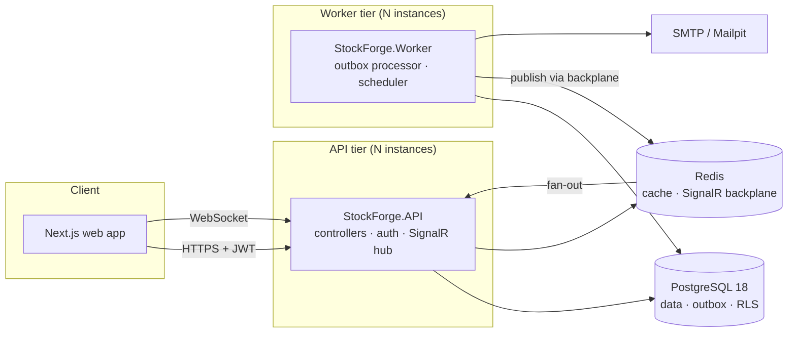
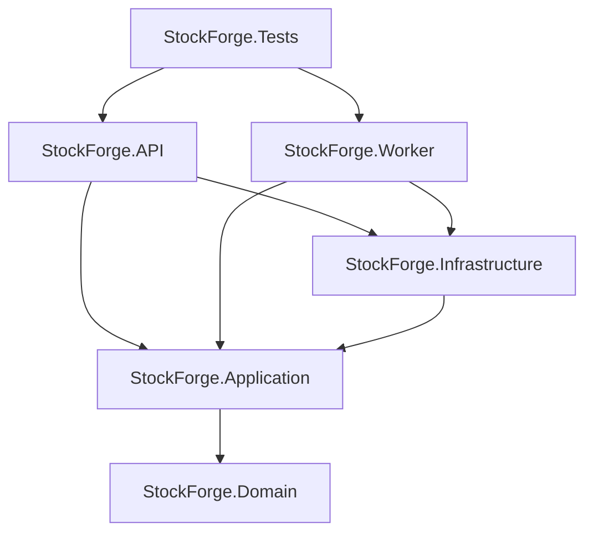
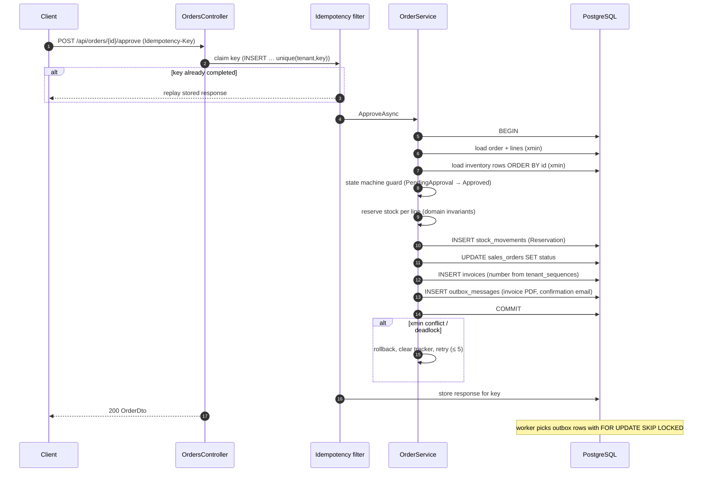
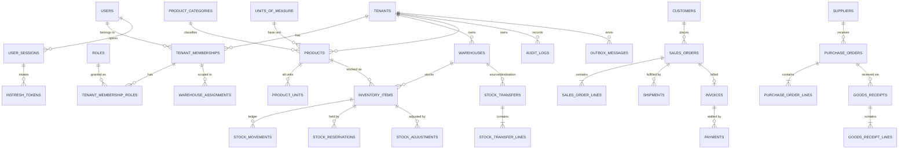

# StockForge — Architecture

StockForge is a multi-tenant inventory, order management and fulfillment platform. This document records the
requirements analysis, the architectural decisions, the project structure, the database design and the
implementation roadmap. Companion documents:

| Document | Contents |
|---|---|
| [MULTI-TENANCY.md](MULTI-TENANCY.md) | The four tenant-isolation layers and how to add a tenant-owned table safely |
| [AUTHENTICATION.md](AUTHENTICATION.md) | Login, refresh-token rotation, sessions, RBAC and permissions |
| [INVENTORY.md](INVENTORY.md) | Stock ledger, concurrency control and the stock operations |
| [DATABASE.md](DATABASE.md) | Full ERD and table reference |
| [API.md](API.md) | Endpoint catalogue (Swagger UI is the live reference) |
| [DEPLOYMENT.md](DEPLOYMENT.md) | Docker, environment variables and local development |

---

## 1. Requirements analysis

The specification is large; these are the requirements that shape the architecture. Everything else is
feature work that sits on top of them.

| # | Driving requirement | Architectural consequence |
|---|---|---|
| R1 | Many organizations share one deployment; no cross-tenant access through crafted requests or IDs | Tenant resolved **only** from validated JWT claims + live membership check; isolation enforced in four independent layers (app, EF filters, composite FKs, PostgreSQL RLS) |
| R2 | Inventory must never oversell under concurrency | Balances are rows with an `xmin` concurrency token **and** `CHECK` constraints; every mutation runs in a retried transaction |
| R3 | Every inventory change is immutable and auditable | Append-only `stock_movements` ledger; `UPDATE`/`DELETE` revoked from the application role and blocked by trigger |
| R4 | Order approval/processing is all-or-nothing and safe to retry | Single EF transaction per use case, idempotency keys stored in the DB, state machine guards, unique constraints as the last line of defence |
| R5 | Background work (PDFs, emails, notifications) must survive restarts | Transactional outbox in PostgreSQL, consumed by `StockForge.Worker` with `FOR UPDATE SKIP LOCKED`, retries and dead-lettering |
| R6 | Horizontal scaling with no local in-memory state | Stateless JWT + DB-backed sessions, Redis distributed cache, Redis SignalR backplane, DataProtection keys in PostgreSQL, files stored in PostgreSQL (swappable for S3) |
| R7 | Granular permissions, not just role names | Permission constants; roles map to permission sets stored as Identity role claims; per-member extra grants; per-warehouse scoping |
| R8 | Real-time dashboards scoped per tenant/warehouse | SignalR groups derived server-side from claims; clients can never name a tenant |

### Technology choices (versions pinned in `Directory.Packages.props` and `web/package.json`)

| Area | Choice | Notes |
|---|---|---|
| Runtime | .NET 11 / C# 15 / ASP.NET Core 11 | Latest GA; every dependency has an 11.x-compatible release |
| Data | PostgreSQL 18, EF Core 11, Npgsql 11, snake_case naming | `xmin` row versions, RLS, `jsonb`, `text[]` |
| Identity | ASP.NET Core Identity (Guid keys) + JWT bearer + rotating refresh tokens | PBKDF2 password hashing, lockout |
| Validation | FluentValidation 12 | Run by an MVC action filter, results returned as RFC 9457 problem details |
| Logging | Serilog (compact JSON to stdout) | Request logging excludes query strings and bodies; no tokens in logs |
| API docs | Built-in OpenAPI document + Swagger UI | `/swagger` in Development |
| Real time | SignalR + Redis backplane | `/hubs/notifications` |
| Cache | Redis via `IDistributedCache` | Membership/permission snapshots, invalidated on change |
| Background | `BackgroundService` + PostgreSQL outbox | `IJobQueue` abstraction allows a later Hangfire swap |
| PDF | QuestPDF (Community licence) | Generated in the worker |
| Email | MailKit → SMTP (Mailpit in development) | |
| Frontend | Next.js 16 (App Router), React 19, TypeScript 5.9, Tailwind CSS 4, TanStack Query 5, `@microsoft/signalr`, Recharts 3 | TypeScript 5.9 rather than 7.x because the Next.js type-checker uses the TS compiler API |
| Tests | xUnit v3, Testcontainers (real PostgreSQL), `WebApplicationFactory` | Isolation and concurrency tests must run against real PostgreSQL to exercise RLS and `xmin` |

---

## 2. System architecture



**Modular monolith.** One deployable API and one deployable worker share the same Domain/Application/
Infrastructure assemblies. Business modules (Identity & Tenancy, Catalog, Inventory, Orders, Procurement,
Billing, Analytics, Audit) are separated by folder and namespace inside each layer. They talk through
application services and domain events, never by reaching into each other's tables. A module can later be
extracted without rewriting its domain.

### Clean Architecture layers



| Project | Responsibility | May reference |
|---|---|---|
| `StockForge.Domain` | Entities, value objects, enums, invariants, domain events, domain exceptions. No EF, no ASP.NET. | — |
| `StockForge.Application` | Use cases (application services), DTOs, validators, permission catalogue, abstractions (`IAppDbContext`, `ICurrentUser`, `ITenantContext`, `IJobQueue`, `IRealtimeNotifier`, `IFileStorage`). | Domain, EF Core abstractions |
| `StockForge.Infrastructure` | EF Core `DbContext`, configurations, migrations, interceptors (tenant, audit, outbox), Identity, JWT, Redis cache, file storage, email, PDF, seeding. | Application, Domain |
| `StockForge.API` | Controllers, middleware (exception handling, tenant resolution, correlation), authorization policies, SignalR hub, OpenAPI, rate limiting, health checks. | Application, Infrastructure |
| `StockForge.Worker` | Outbox processor, job handlers, scheduled jobs (daily summaries, low stock, overdue invoices). | Application, Infrastructure |
| `StockForge.Tests` | Unit tests (domain, validators) and integration tests (Testcontainers PostgreSQL). | All |

**About abstractions.** The specification warns against needless abstractions. The application layer works
directly against `IAppDbContext`, which exposes EF `DbSet`s. There is no generic repository, because EF
already is a repository and unit of work. Abstractions exist only where they buy something concrete:

* `ITransactionRunner`: the transaction, retry and concurrency-conflict policy lives in one place.
* `ITenantContext` / `ICurrentUser`: the API resolves these from claims; the worker sets them per job.
* `IJobQueue`: the outbox today, Hangfire later.
* `IRealtimeNotifier`: SignalR in production, a recording fake in tests.
* `IFileStorage`: PostgreSQL today, S3 later.

---

## 3. Repository layout

```
stockforge/
├── global.json                      # pins the .NET 11 SDK
├── Directory.Build.props            # TFM, nullable, analyzers, warnings-as-errors
├── Directory.Packages.props         # central NuGet version management
├── StockForge.slnx
├── src/
│   ├── StockForge.Domain/
│   │   ├── Common/                  # Entity, ITenantOwned, IAuditable, DomainException, domain events
│   │   ├── Tenancy/                 # Tenant, TenantSettings, TenantMembership, WarehouseAssignment
│   │   ├── Catalog/                 # Product, ProductCategory, UnitOfMeasure, ProductUnit
│   │   ├── Inventory/               # Warehouse, InventoryItem, StockMovement, StockReservation,
│   │   │                            # StockAdjustment, StockTransfer
│   │   ├── Sales/                   # Customer, SalesOrder, Shipment, SalesReturn        (phase 2)
│   │   ├── Billing/                 # Invoice, Payment                                   (phase 2/4)
│   │   ├── Procurement/             # Supplier, PurchaseOrder, GoodsReceipt              (phase 3)
│   │   └── Platform/                # AuditLog, OutboxMessage, IdempotencyRecord, StoredFile
│   ├── StockForge.Application/
│   │   ├── Abstractions/            # IAppDbContext, ITenantContext, ICurrentUser, IJobQueue, …
│   │   ├── Security/                # Permissions, RoleNames, RolePermissionDefaults
│   │   ├── Common/                  # PagedResult, exceptions, validation helpers
│   │   └── <Module>/                # services, DTOs, validators per module
│   ├── StockForge.Infrastructure/
│   │   ├── Persistence/             # AppDbContext, Configurations/, Interceptors/, Migrations/
│   │   ├── Identity/                # ApplicationUser, AuthService, TokenService, MembershipResolver
│   │   ├── Jobs/                    # OutboxJobQueue, job contracts
│   │   ├── Realtime/                # SignalR notifier
│   │   ├── Files/ Email/ Pdf/       # adapters
│   │   └── Seeding/                 # development seed data
│   ├── StockForge.API/
│   │   ├── Controllers/
│   │   ├── Authorization/           # permission policy provider + handler
│   │   ├── Middleware/              # exception → problem details, tenant resolution, correlation id
│   │   ├── Hubs/                    # NotificationsHub
│   │   └── Program.cs
│   └── StockForge.Worker/
│       ├── Outbox/                  # OutboxProcessor (BackgroundService)
│       ├── Handlers/                # one IJobHandler per job type
│       └── Scheduling/              # ScheduledJobService (daily summaries, low-stock scan)
├── tests/StockForge.Tests/
│   ├── Unit/
│   └── Integration/                 # Testcontainers fixture, isolation, concurrency, auth tests
├── web/                             # Next.js frontend
├── docker/                          # postgres init scripts
├── docker-compose.yml
├── .github/workflows/ci.yml
└── docs/
```

---

## 4. Multi-tenancy design (summary)

Full detail: [MULTI-TENANCY.md](MULTI-TENANCY.md).

1. **Resolution.** The tenant comes from the `tid` claim of a signed access token. On every request,
   `TenantResolutionMiddleware` loads a *membership snapshot* for `(session, user, tenant)`: the session is
   not revoked, the membership and tenant are active, and the roles, permissions and warehouses are known.
   The snapshot is cached in Redis for 30 s and evicted on any change. A `TenantId` in a request body or
   query string is never used for scoping.
2. **Application layer.** Services never accept a tenant parameter. `ITenantContext.TenantId` is the only
   source, and `SaveChanges` stamps it on inserts and rejects writes to rows of another tenant.
3. **EF Core global query filters.** Every `ITenantOwned` entity gets a named filter
   `TenantId == CurrentTenantId`. With no tenant (an anonymous or platform context) the filter matches
   nothing: it fails closed.
4. **Database constraints.** Principal tables expose a unique `(tenant_id, id)` key, and dependents reference
   it through composite foreign keys such as `(tenant_id, product_id) → products(tenant_id, id)`. A row can
   never point at another tenant's product, even through raw SQL.
5. **PostgreSQL Row-Level Security.** The application connects as `stockforge_app`, a non-owner role that
   RLS applies to. A connection interceptor runs `set_config('app.tenant_id', …)` on every connection open.
   Each tenant table has a policy of the form
   `tenant_id = NULLIF(current_setting('app.tenant_id', true), '')::uuid`. An integration test asserts that
   every table with a `tenant_id` column has RLS enabled, so a newly added table cannot silently skip it.

Platform tables (`tenants`, Identity tables, `tenant_memberships`, `user_sessions`, `refresh_tokens`,
`outbox_messages`) are not tenant-filtered. They are only reached by user id or by the trusted worker.

---

## 5. Inventory consistency design (summary)

Full detail: [INVENTORY.md](INVENTORY.md).

* `inventory_items` holds one row per `(tenant, warehouse, product)` with `quantity_on_hand`,
  `quantity_reserved` and `average_unit_cost`. **Available = on hand − reserved.**
* Database `CHECK` constraints enforce `on_hand ≥ 0`, `reserved ≥ 0` and `reserved ≤ on_hand`. Even buggy
  code cannot oversell.
* The PostgreSQL `xmin` system column is the EF concurrency token. When two requests race for the last
  units, one commits and the other gets `DbUpdateConcurrencyException`. `ITransactionRunner` then rolls back,
  clears the change tracker and re-runs the whole use case against fresh data (bounded retries with jitter),
  and the retried attempt fails cleanly with `insufficient_stock` if the stock is gone.
* Transient failures (deadlock `40P01`, serialization failure `40001`, connection drops) are retried by the
  Npgsql execution strategy. Multi-row operations touch inventory rows in a deterministic order (by id), so
  deadlocks stay rare.
* Every mutation goes through `InventoryLedger`, which changes the balance and appends a `stock_movements`
  row in the same transaction. Movements record the signed on-hand delta, the reserved delta and the
  resulting balances, so the ledger can be replayed and reconciled.

---

## 6. Order processing (phase 2, designed now)



Retry safety comes from three independent mechanisms:

1. Idempotency keys. A `(tenant_id, key)` unique index lets a replay return the stored response.
2. State-machine guards. An already approved order cannot be approved twice.
3. Unique constraints. These cover `sales_orders(tenant_id, idempotency_key)`,
   `invoices(tenant_id, sales_order_id)` and `invoices(tenant_id, number)`.

Inventory can therefore never be deducted twice and an invoice never duplicated, even if the idempotency
record itself is lost.

---

## 7. Database schema

The full ERD and column reference are in [DATABASE.md](DATABASE.md). Core entities:



Conventions:

* Primary keys are UUIDv7 (`Guid.CreateVersion7()`): sortable, index-friendly and safe to generate on the
  client.
* Every tenant-owned table has `tenant_id uuid NOT NULL` as the **leading column of every index**, so
  per-tenant scans stay cheap and partitioning by tenant remains possible later.
* Money is `numeric(18,2)`, unit costs `numeric(18,4)` and quantities `numeric(18,3)`, to support kg, litres
  and other fractional units.
* Business numbers (SKU, order, invoice, PO, transfer) come from `tenant_sequences`, which is gap-free
  within a transaction and unique per tenant.
* `created_at` / `created_by` / `updated_at` / `updated_by` are stamped by a `SaveChanges` interceptor.
* Ledger and audit tables are append-only: `UPDATE`/`DELETE` privileges are revoked from `stockforge_app`,
  and a trigger blocks the same operations for every role.

---

## 8. Cross-cutting concerns

| Concern | Implementation |
|---|---|
| Errors | `GlobalExceptionHandler` maps domain/application exceptions to RFC 9457 problem details with a stable `code` (`not_found`, `validation_failed`, `insufficient_stock`, `concurrency_conflict`, `invalid_state`, `forbidden`, `duplicate`) |
| Validation | FluentValidation validators discovered by assembly scan; `ValidationFilter` runs them before every action |
| Audit | `AuditInterceptor` writes `audit_logs` rows (old/new JSON with sensitive fields stripped) in the same transaction as the change; explicit audit entries for login, approvals and security events |
| Correlation | `X-Correlation-Id` accepted or generated; pushed into Serilog `LogContext`, audit rows and outbox messages |
| Rate limiting | ASP.NET Core rate limiter: a strict partitioned policy on auth endpoints, a global per-user limiter on everything else. Account lockout is DB-backed, so it holds across instances |
| Security headers | HSTS and HTTPS redirection outside Development; `X-Content-Type-Options`, `Referrer-Policy`, `X-Frame-Options` |
| CORS | Explicit origin allow-list from configuration, credentials allowed for the refresh cookie |
| Secrets | Configuration and environment variables only; nothing sensitive in `appsettings.json` beyond development defaults |
| Health | `/health/live` (process) and `/health/ready` (PostgreSQL + Redis) |
| Scale-out | No in-process state: sessions in PostgreSQL, cache in Redis, SignalR over the Redis backplane, DataProtection keys in PostgreSQL, files in PostgreSQL |

---

## 9. Implementation roadmap

Each phase ends with: build, migration, tests, API verification and a documentation update.

| Phase | Scope | Status |
|---|---|---|
| **0. Foundation** | Solution, central packages, Docker Compose (PostgreSQL, Redis, Mailpit), CI, Serilog, problem details, OpenAPI, health checks | in progress |
| **1. Identity, tenancy & inventory** | Identity + JWT + refresh rotation + sessions + password reset + lockout; organization onboarding; users/roles/permissions/warehouse assignment; platform admin; four-layer tenant isolation; warehouses, categories, units, products (SKU generation, barcodes, images); inventory balances, stock in/out, damaged, returned, reservations, adjustments with approval, transfers, valuation, movement history; audit log; outbox + worker skeleton; SignalR hub; frontend shell and these modules; isolation, concurrency and auth tests | in progress |
| **2. Orders, fulfillment & invoicing** | Customers; sales orders with discounts/taxes; configurable approval thresholds; transactional approve → reserve → invoice; pick/pack/ship; partial fulfillment; returns; idempotency keys; invoice numbering; PDF generation in the worker; order emails | next |
| 3. Procurement | Suppliers, supplier products, purchase orders + approval, goods receipt notes with partial deliveries → stock in, supplier invoices and payments | planned |
| 4. Finance & analytics | Payments, outstanding balances, overdue job, finance dashboard, monthly performance, exportable reports (CSV), scheduled reports | planned |
| 5. Hardening | Load tests, Hangfire adapter (optional), S3 file storage adapter, OpenTelemetry traces, backup/restore runbook | planned |
