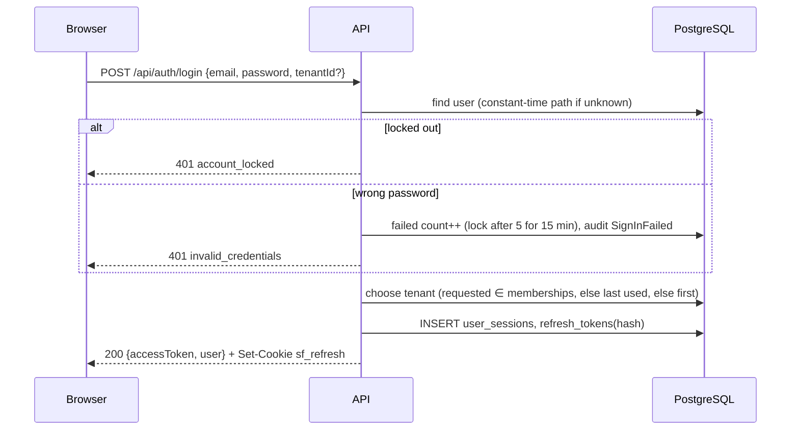

# Authentication, sessions and authorization

## Tokens at a glance

| Token | Lifetime | Where it lives | Contents |
|---|---|---|---|
| Access token (JWT, HS256) | 15 min (`Jwt:AccessTokenMinutes`) | Browser memory only | `sub`, `sid` (session), `tid` (tenant), `email`, `name`, `role`, `pa` (platform admin), `jti` |
| Refresh token (opaque, 384-bit random) | 14 days sliding (`Jwt:RefreshTokenDays`), session max 30 days (`Jwt:SessionMaxDays`) | `sf_refresh` cookie: HttpOnly, Secure, SameSite=Strict, `Path=/api/auth` | none; only its SHA-256 hash is stored in `refresh_tokens` |

Permissions are **not** embedded in the JWT. Every request resolves them from the session's membership
snapshot (see [MULTI-TENANCY.md](MULTI-TENANCY.md)), so revoking a session, changing a role or suspending an
organization takes effect immediately rather than when the token expires.

Non-browser clients may send `X-Refresh-Token-Transport: body` to receive the refresh token in the JSON
response and pass it back in `{"refreshToken": "..."}`.

## Flows

### Organization onboarding (self-service)

`POST /api/auth/register` runs in one transaction. It creates the tenant (with a unique slug), the default
units of measure (EA, BOX, CS, PK, KG, L, M) and a `MAIN` warehouse, then creates the user and grants them
`OrganizationAdmin`. On success it opens a session and returns tokens. A platform super-administrator can
also create organizations (`POST /api/platform/tenants`); the first administrator then receives an
invitation email.

### Sign-in



* Unknown emails and wrong passwords return the same `invalid_credentials` and take the same time (a dummy
  hash is verified), so responses do not reveal which accounts exist.
* Lockout is stored in the Identity table, so it holds across all API instances.
* The `auth` rate-limit policy allows 10 attempts per minute per client IP.

### Refresh-token rotation and reuse detection

```mermaid
sequenceDiagram
    participant B as Browser
    participant API
    participant DB as PostgreSQL
    B->>API: POST /api/auth/refresh (cookie)
    API->>DB: find token by SHA-256
    alt token already rotated (outside 15 s grace window)
        API->>DB: revoke whole session + all its tokens, audit RefreshTokenReuseDetected
        API-->>B: 401 invalid_refresh_token
    else valid
        API->>DB: UPDATE refresh_tokens SET revoked_at, replaced_by WHERE id=@id AND revoked_at IS NULL
        API->>DB: INSERT new refresh token; extend session (capped at max age)
        API-->>B: 200 new access token + new cookie
    end
```

* Presenting a token that was already rotated means it was copied. The whole session is revoked: the
  attacker's copy, the legitimate successor and the session's access tokens all stop working.
* Two browser tabs refreshing at the same moment are a benign race. A reuse within
  `Jwt:RefreshReuseGraceSeconds` (15 s) of the rotation is tolerated. The tests set the window to 0 to prove
  detection.
* The rotation itself is an atomic conditional `UPDATE`, so concurrent refreshes cannot fork a session.

### Sessions and sign-out

* `GET /api/auth/sessions` lists the user's active sessions (device/IP, last seen).
  `DELETE /api/auth/sessions/{id}` revokes one.
* `POST /api/auth/logout` revokes the current session and its refresh tokens, evicts the cached snapshot and
  clears the cookie. The access token is rejected on the very next request (`session_invalid`).
* Administrators can revoke all of a member's sessions (`POST /api/users/{id}/revoke-sessions`).
  Deactivating a member does this automatically.

### Password reset and invitations

* `POST /api/auth/forgot-password` always returns `202`. For an active account it enqueues an email with a
  2-hour Identity reset token. The outbox payload is **encrypted** with Data Protection (keys in PostgreSQL)
  and wiped after delivery.
* `POST /api/auth/reset-password` resets the password, clears lockout and revokes **all** sessions.
* Invitations (`POST /api/users`) create the account without a password and email a 3-day token
  (`InvitationTokenProvider`). `POST /api/auth/accept-invitation` sets the password and signs the user in.
  An existing user who is added to another organization receives a notification instead.
* `POST /api/auth/change-password` requires the current password and revokes every other session.

## Authorization model

* **Permissions** are constants in `Application/Security/Permissions.cs` (for example `inventory.receive`,
  `inventory.adjust.approve`, `users.manage`).
* **Roles** are named permission bundles (`RolePermissionDefaults`), stored as Identity role claims and synced
  on every start. Assignable tenant roles: OrganizationAdmin, InventoryManager, WarehouseManager,
  WarehouseStaff, ProcurementOfficer, SalesOfficer, FinanceManager, Auditor. `SuperAdmin` is a platform role
  with no tenant data access.
* **Per-member grants.** A membership can hold extra permissions (`GrantedPermissions`) on top of its roles.
* **Warehouse scope.** Members without `inventory.view_all_warehouses` are limited to their assigned
  warehouses, both in queries and for stock operations.
* **Enforcement.** Controllers use `[HasPermission("a", "b")]` (any of the listed permissions; stack
  attributes for all-of). `PermissionPolicyProvider` builds policies on demand and
  `PermissionAuthorizationHandler` checks the request's snapshot. Resource checks such as warehouse access
  and segregation of duties live in the application services.
* **No privilege escalation.** A member can only assign roles or grants whose permissions they hold
  themselves. The last active OrganizationAdmin cannot be demoted or deactivated.
* **Segregation of duties.** A pending stock adjustment cannot be approved by the member who requested it.

| Role | Highlights |
|---|---|
| OrganizationAdmin | Everything in the organization: users, roles, warehouses, settings, reports, audit |
| InventoryManager | Products, all warehouses, transfers, approve adjustments, analytics, valuation |
| WarehouseManager | Assigned warehouses: receive, issue, counts, transfers, fulfillment |
| WarehouseStaff | Assigned warehouses: record movements and counts, picking/packing; cannot approve, cannot see finance |
| ProcurementOfficer | Suppliers and purchase orders (phase 3) |
| SalesOfficer | Customers, orders, reservations (phase 2) |
| FinanceManager | Invoices, payments, financial reports, approvals of orders/POs, valuation |
| Auditor | Read-only across operations, finance and the audit trail |

## Security controls

* Passwords are hashed with ASP.NET Core Identity's PBKDF2 (HMAC-SHA512, high iteration count). Policy:
  at least 10 characters, with upper case, lower case and a digit.
* The JWT signing key must be at least 32 bytes and is supplied by configuration/secret store only.
  Algorithm, issuer, audience and lifetime are validated, with 30 s clock skew.
* SignalR WebSocket connections carry the token in the `access_token` query parameter. Request logging
  records the path without the query string, so tokens never reach the logs.
* Every security event is written to the immutable audit log: sign-in, sign-out, failed sign-in, lockout,
  unlock, reset, refresh-token reuse, session revocation, invitation, suspension.
