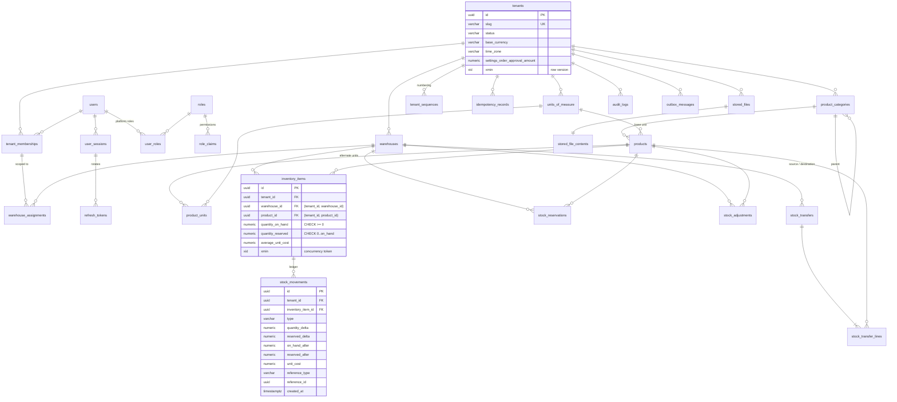

# Database

PostgreSQL 18, accessed through EF Core 11 / Npgsql with snake_case naming. The schema is defined by the
migrations in `src/StockForge.Infrastructure/Persistence/Migrations`:

* `InitialSchema` is generated from the model.
* `SecurityPolicies` is hand-written: runtime role, grants, append-only triggers, RLS and platform functions.

## Entity-relationship diagram



Phase 2 and 3 tables (customers, sales orders, shipments, invoices, payments, suppliers, purchase orders,
goods receipts) follow the same conventions and are shown in [ARCHITECTURE.md](ARCHITECTURE.md#7-database-schema).

## Conventions

* **Keys.** UUIDv7 primary keys generated in the domain (`Guid.CreateVersion7()`), configured
  `ValueGeneratedNever`. Tenant principals also expose a unique `(tenant_id, id)` alternate key, and
  dependents reference it with composite FKs.
* **Indexes.** `tenant_id` leads every index on tenant-owned tables.
* **Types.** Money `numeric(18,2)`, costs `numeric(18,4)`, quantities `numeric(18,3)`, fractional tax rates
  `numeric(6,5)`. Enums are stored as strings, timestamps as `timestamptz` in UTC, and lists (roles,
  permissions, changed properties) as `text[]`.
* **Concurrency.** `xmin` is the row version on tenants, memberships, warehouses, products, inventory items,
  reservations, adjustments and transfers. Update DTOs carry `version` for optimistic UI concurrency.
* **Numbering.** `tenant_sequences (tenant_id, name, next_value)` is incremented with an atomic upsert inside
  the business transaction. Formats: `TRF-000001`, `ADJ-000001`, SKU `{CATEGORY}-000001`, internal EAN-13
  barcodes in the GS1 in-store range (prefix 2).

## Table reference

| Table | Purpose | Key constraints |
|---|---|---|
| `tenants` | Organizations and their settings (approval thresholds, tax default, alerts) | unique `slug` |
| `users`, `roles`, `user_roles`, `role_claims`, `user_claims`, `user_logins`, `user_tokens` | ASP.NET Core Identity | unique normalized email |
| `tenant_memberships` | User ↔ organization, tenant roles (`text[]`), extra grants | unique `(tenant_id, user_id)` |
| `warehouse_assignments` | Warehouse scope of a membership | FK `(tenant_id, membership_id)`, `(tenant_id, warehouse_id)` |
| `user_sessions` | Signed-in devices; revocation | |
| `refresh_tokens` | SHA-256 of rotating refresh tokens, replacement chain | unique `token_hash` |
| `warehouses` | Locations (DC, warehouse, store, 3PL) | unique `(tenant_id, code)` |
| `units_of_measure` | EA, BOX, KG… | unique `(tenant_id, code)` |
| `product_categories` | Hierarchy; code doubles as the SKU prefix | unique `(tenant_id, code)`, `(tenant_id, name)` |
| `products` | Catalog, prices, tax, reorder thresholds, image | unique `(tenant_id, sku)`, partial unique `(tenant_id, barcode)`; price CHECKs |
| `product_units` | Alternate units and conversion factors | unique `(tenant_id, product_id, unit_of_measure_id)`; `factor > 0` |
| `inventory_items` | Balances | unique `(tenant_id, warehouse_id, product_id)`; non-negative CHECKs |
| `stock_movements` | Immutable ledger | append-only (privileges + trigger) |
| `stock_reservations` | Holds with partial consumption | `consumed + released <= quantity` |
| `stock_adjustments` | Counts and corrections, approval state | unique `(tenant_id, number)` |
| `stock_transfers`, `stock_transfer_lines` | Inter-warehouse transfers | unique number; source ≠ destination; one line per product |
| `tenant_sequences` | Gap-free document numbering | PK `(tenant_id, name)` |
| `idempotency_records` | Stored responses for idempotent retries (24 h) | unique `(tenant_id, key)` |
| `stored_files`, `stored_file_contents` | Product images, generated documents | content FK `(tenant_id, file_id)` |
| `audit_logs` | Immutable audit trail (JSON old/new values) | append-only; RLS on read |
| `outbox_messages` | Durable background jobs | index `(status, next_attempt_at)`; partial unique dedup key |
| `scheduled_job_runs` | One execution per scheduled period across instances | unique `(job_name, run_key)` |
| `data_protection_keys` | ASP.NET Core Data Protection key ring shared by all instances | |

## Roles and privileges

| Role | Used by | Privileges |
|---|---|---|
| Owner (e.g. `stockforge`/`postgres`) | Migrator only | DDL; owns tables (RLS does not apply to the owner, triggers do) |
| `stockforge_app` | API and worker | `SELECT/INSERT/UPDATE/DELETE` on tables except `UPDATE/DELETE/TRUNCATE` on `stock_movements` and `audit_logs`; no access to `__ef_migrations_history`; RLS enforced |

## Changing the schema

```bash
dotnet tool restore
dotnet ef migrations add <Name> -p src/StockForge.Infrastructure -s src/StockForge.Infrastructure -o Persistence/Migrations
# New tenant-owned table? End Up() with:  migrationBuilder.Sql("SELECT stockforge_apply_tenant_rls();");
dotnet ef migrations has-pending-model-changes -p src/StockForge.Infrastructure -s src/StockForge.Infrastructure   # CI runs this
```

The design-time factory uses `STOCKFORGE_MIGRATIONS_CONNECTION` (owner connection) or local defaults.
