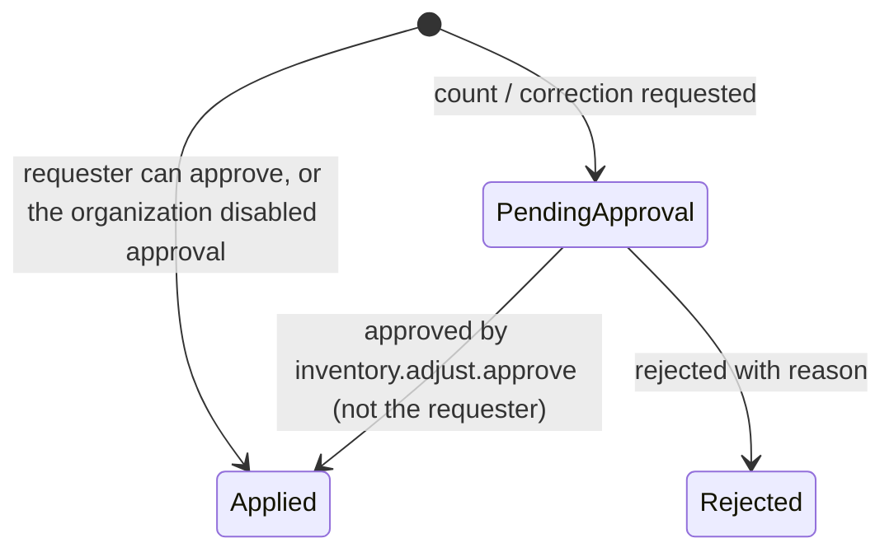
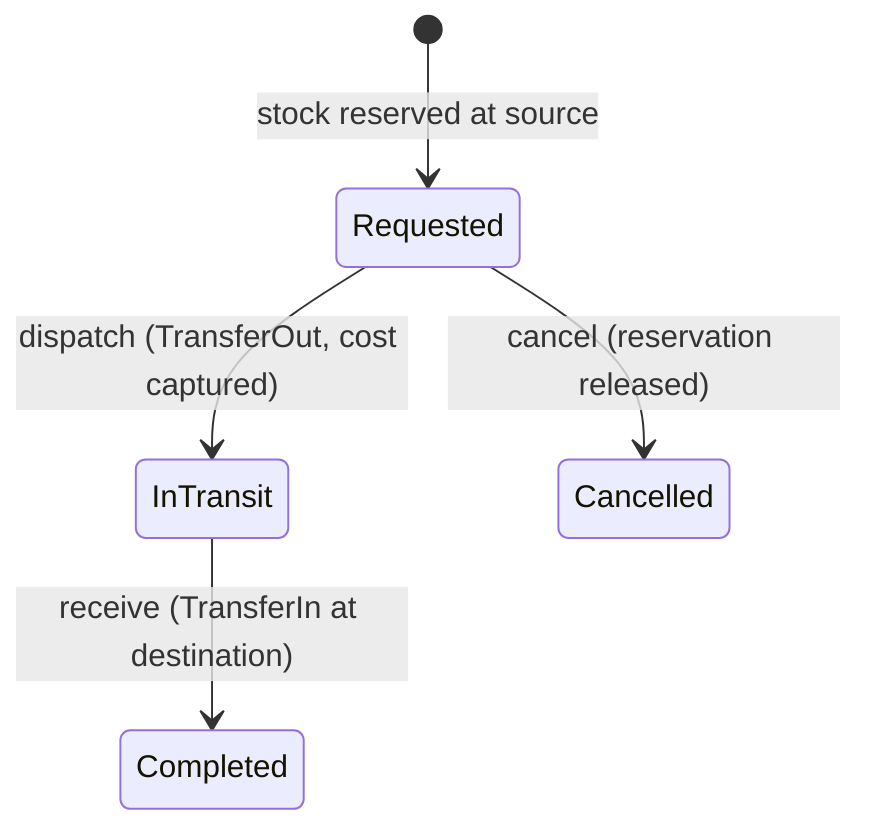

# Inventory: ledger, operations and consistency

## Model

| Concept | Table | Notes |
|---|---|---|
| Balance | `inventory_items` | One row per (tenant, warehouse, product): `quantity_on_hand`, `quantity_reserved`, `average_unit_cost`; **available = on hand − reserved** |
| Ledger | `stock_movements` | Immutable. Signed `quantity_delta` (on hand) and `reserved_delta`, resulting balances, unit cost, reference document, user, correlation id |
| Holds | `stock_reservations` | Stock earmarked for a document (manual hold, transfer, and later sales orders); supports partial consumption |
| Corrections | `stock_adjustments` | Counts and corrections with an approval workflow |
| Transfers | `stock_transfers`, `stock_transfer_lines` | Request → dispatch → receive (or cancel) |

All quantities are stored in the product's **base unit** with `numeric(18,3)`. Requests may use an
alternate unit (`unitId`); `Product.ToBaseQuantity` converts it (BOX = 5 × EA, for example) and the unit
cost is divided by the same factor.

### Movement types

| Type | On hand | Reserved | Produced by |
|---|---|---|---|
| `StockIn` | + | | `POST /api/inventory/stock-in` (goods receipt in phase 3) |
| `StockOut` | − | | `POST /api/inventory/stock-out`; shipping reserved order stock in phase 2 (− / −) |
| `Damaged` | − | | `POST /api/inventory/damaged` (write-off at average cost) |
| `Returned` | + | | `POST /api/inventory/returns` (customer returns) |
| `Reservation` | | + | Manual holds, transfer requests (sales orders in phase 2) |
| `Release` | | − | Releasing or expiring a hold, cancelling a transfer |
| `TransferOut` | − | − | Dispatching a transfer (consumes its reservation) |
| `TransferIn` | + | | Receiving a transfer at the destination, at the source's average cost |
| `Adjustment` | ± | | Applying an approved count or correction |

### Valuation

Perpetual **weighted-average cost**. A receipt recalculates
`avg = (onHand × avg + qty × cost) / (onHand + qty)`. Issues, damage and transfers out use the current
average, and transfers carry the source's average into the destination. `GET /api/inventory/valuation`
reports units, cost value and retail value (on hand × selling price) per warehouse and per category.

## Invariants: why stock can never be oversold

1. **Domain.** `InventoryItem.Reserve`, `Issue` and `Adjust` throw `InsufficientStockException` if available
   stock would be exceeded. `Release` and `ConsumeReserved` cannot exceed the reserved quantity.
2. **Database.** `CHECK (quantity_on_hand >= 0)`, `CHECK (quantity_reserved >= 0)` and
   `CHECK (quantity_reserved <= quantity_on_hand)` reject a bad write even if code is wrong.
3. **Concurrency.** The PostgreSQL `xmin` system column is the EF concurrency token. When two transactions
   read the same balance and both try to update it, the second `UPDATE … WHERE xmin = @original` affects 0
   rows and raises `DbUpdateConcurrencyException`.
4. **Retry.** `TransactionRunner` rolls back, clears the change tracker and re-runs the whole use case on
   fresh data, up to 8 attempts with jittered back-off. The retried attempt sees the reduced stock and
   either succeeds or fails cleanly with `insufficient_stock` (HTTP 409, with `available` in the problem
   body).
5. **Transient errors.** Deadlocks (`40P01`), serialization failures (`40001`) and dropped connections are
   retried by the Npgsql execution strategy. Balance rows are read in id order and EF writes them in key
   order, so multi-line operations lock rows in a consistent order and rarely deadlock.
6. **First receipt race.** A missing balance row is created with
   `INSERT … ON CONFLICT (tenant_id, warehouse_id, product_id) DO NOTHING`. Concurrent first receipts block
   on the unique index and then reuse the row instead of failing.

`Simultaneous_reservations_for_limited_stock_never_oversell` fires 20 concurrent 10-unit reservations at
50 units: exactly 5 succeed, 15 get `insufficient_stock`, and the ledger reconciles to the balance.

### Atomicity

Every operation runs inside one transaction: the balance update, the ledger row(s), the reservation or
document state change, the audit rows, the outbox jobs (for example a low-stock alert) and the document
number allocation. A failure anywhere rolls everything back, including the number sequence, so numbering
stays gap-free. Domain events (for SignalR) are published only **after** commit.

### Reconciliation

Two invariants hold at all times and are asserted by the tests:

```sql
-- every balance equals the sum of its ledger
SELECT count(*) FROM inventory_items i
LEFT JOIN (SELECT inventory_item_id, sum(quantity_delta) on_hand, sum(reserved_delta) reserved
           FROM stock_movements GROUP BY 1) m ON m.inventory_item_id = i.id
WHERE i.quantity_on_hand <> coalesce(m.on_hand, 0) OR i.quantity_reserved <> coalesce(m.reserved, 0);  -- = 0

-- reserved stock is fully explained by active reservations
SELECT sum(quantity_reserved) FROM inventory_items
  = SELECT sum(quantity - quantity_consumed - quantity_released) FROM stock_reservations WHERE status = 'Active';
```

## Workflows

### Stock adjustments



A count stores the counted quantity and the system quantity at request time. The variance is fixed when
the request is made, so movements recorded between the count and its approval are preserved.

### Transfers



Dispatch requires access to the source warehouse and `inventory.transfer`; receiving requires access to
the destination and `inventory.receive`. Partial receipts (loss in transit) are planned for a later phase;
today such loss is recorded as an adjustment at the destination.

### Reservations

Manual holds (`POST /api/reservations`) may expire. The worker releases expired holds every 15 minutes.
Reservations owned by a transfer (and by orders in phase 2) can only be released through that document.

### Low-stock alerts

A product is low on stock in a warehouse when `available <= reorder_level`. The ledger enqueues a
`LowStockAlertJob` in the same transaction **only when a movement crosses the threshold**, so alerts don't
repeat on every movement. The worker re-checks the live balance, pushes `inventory.low_stock` over SignalR
and emails inventory and warehouse managers.

## Idempotency

The stock endpoints accept an `Idempotency-Key` header (stock in/out, damaged, returns, reservations,
counts, corrections, transfers). See [API.md](API.md#idempotency).
