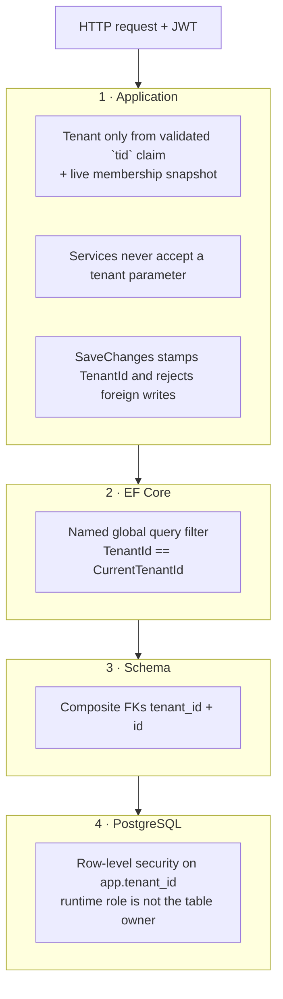

# Multi-tenant isolation

StockForge runs every organization (tenant) in one database. Isolation does not rely on any single
mechanism. Four independent layers each prevent cross-tenant access on their own, and integration tests
prove each one (`tests/StockForge.Tests/Integration/TenantIsolationTests.cs`).



## 1. Tenant resolution (never trust the client)

1. The client sends `Authorization: Bearer <access token>`. The token's `tid` claim names the organization.
   It is signed, so the client cannot change it.
2. `JwtBearerEvents.OnTokenValidated` (`src/StockForge.API/Hosting/ApiSupport.cs`) loads the **membership
   snapshot** for the token's session (`MembershipSnapshotProvider`). The snapshot is rejected unless all of
   the following hold:
   * the session (`sid`) exists, is not revoked and has not expired;
   * the user is active and not locked out;
   * the session belongs to the same user and tenant as the token;
   * the membership is active and the tenant is not suspended.
3. The snapshot also carries the roles, the effective permissions (role claims plus per-member grants) and
   the warehouse scope. It is cached in Redis for 30 seconds and evicted whenever any of these change: role
   or warehouse edits, deactivation, logout, session revocation, password reset or tenant suspension.
4. `RequestContextMiddleware` copies the snapshot into the scoped `ScopeContext`, which implements
   `ITenantContext` and `ICurrentUser`. This is **the only place** a request's tenant is set.

A `tenantId` field in a request body or query string is never bound to anything that scopes data. The test
`Tenant_id_in_request_body_is_ignored` shows that a smuggled `tenantId` has no effect.

Switching organization (`POST /api/auth/switch-organization`) verifies the membership, revokes the current
session and issues a new session for the target tenant. A token is therefore always bound to exactly one
tenant.

## 2. Application layer

* Application services take no tenant argument; they read `ITenantContext`.
* The `AuditingInterceptor` (`Infrastructure/Persistence/Interceptors`) runs on every `SaveChanges`:
  * **Insert:** it stamps `TenantId` from the scope. A row that already carries a different tenant, or a scope
    with no tenant, raises `TenantIsolationException`.
  * **Update/delete:** it rejects any row whose original `TenantId` differs from the scope's, and any attempt
    to change `TenantId`.
* `TenantId` and every `Id` are configured `ValueGeneratedNever()`, so EF can never invent a key value. All ids
  are UUIDv7 generated in constructors.
* Warehouse scope: members without `inventory.view_all_warehouses` see and act only on their assigned
  warehouses (`ICurrentUser.AccessibleWarehouseIds`, `EnsureWarehouseAccess`).

## 3. EF Core global query filters

`AppDbContext.ConfigureTenantOwned<T>` adds a **named** filter (`"Tenant"`) to every `ITenantOwned` entity:

```csharp
entity.HasQueryFilter(TenantFilter, e => e.TenantId == CurrentTenantId);
```

`CurrentTenantId` is a context member, so EF parameterizes it per context instance. With no tenant in scope
the filter matches nothing, so the system **fails closed**. The only code that calls `IgnoreQueryFilters()` is
code that must read across tenants by user id: sign-in, session validation and the platform tenant list. RLS
still applies to that code.

## 4. Database constraints

Principal tables expose a unique `(tenant_id, id)` alternate key. Dependents reference it with composite
foreign keys:

```sql
FOREIGN KEY (tenant_id, product_id)   REFERENCES products (tenant_id, id)
FOREIGN KEY (tenant_id, warehouse_id) REFERENCES warehouses (tenant_id, id)
```

An inventory row, movement, reservation, transfer line or product unit therefore cannot point at another
tenant's product or warehouse, **even when written with raw SQL by the table owner**. Every tenant-owned
table also has a plain `tenant_id → tenants(id)` foreign key.

## 5. PostgreSQL row-level security

* **Roles.** Migrations run as the owner (`ConnectionStrings:Migrations`). The API and worker connect as
  `stockforge_app` (`ConnectionStrings:Default`), which owns no table and lacks `BYPASSRLS`, so RLS always
  applies to it. The migration `SecurityPolicies` creates the role and grants DML only.
* **Session setting.** `TenantConnectionInterceptor` and `TenantTransactionInterceptor` run
  `SELECT set_config('app.tenant_id', @tenant, false)` whenever a connection opens and whenever a
  transaction begins. Npgsql resets session state when a pooled connection is returned.
* **Policy.** `stockforge_apply_tenant_rls()` enables RLS on every table that has a `tenant_id` column and
  creates:

  ```sql
  CREATE POLICY tenant_isolation ON <table>
      USING (tenant_id = stockforge_current_tenant())
      WITH CHECK (tenant_id = stockforge_current_tenant());
  -- stockforge_current_tenant() = NULLIF(current_setting('app.tenant_id', true), '')::uuid
  ```

  With no tenant set, the policy matches no rows. A write for another tenant fails with `42501`.
* **Exclusions** (`TenantRls.ExcludedTables`). These tables are read before a tenant is known or by the
  platform worker: `tenant_memberships`, `warehouse_assignments`, `user_sessions`, `refresh_tokens`,
  `outbox_messages` and `audit_logs`. The application layer protects them. `audit_logs` additionally has a
  SELECT policy that restricts reads to the session tenant, while inserts are always allowed because sign-in
  events are written before a tenant is selected.
* **Platform aggregates.** The super-administrator's per-tenant counts come from
  `platform_tenant_stats()`, a `SECURITY DEFINER` function owned by the owner role that returns aggregates
  only.

### Adding a tenant-owned table

1. Implement `ITenantOwned`, usually by deriving from `TenantEntity`. The filter, tenant FK and stamping are
   then automatic.
2. If other tables reference it, call `HasTenantKey()` and reference it through `TenantReference(...)`.
3. Generate the migration, then end its `Up` with:

   ```csharp
   migrationBuilder.Sql("SELECT stockforge_apply_tenant_rls();");
   ```

4. `Every_tenant_owned_table_has_row_level_security` fails if you forget step 3.

## Realtime isolation

SignalR clients never name a group. `NotificationsHub.OnConnectedAsync` validates the snapshot and places
the connection in groups derived only from it:

* `t:{tenant}`;
* `t:{tenant}:w:{warehouse}` for each assigned warehouse;
* `t:{tenant}:p:{permission}` for a small set of permission topics.

`Clients_only_receive_events_of_their_own_organization` verifies this.

## Background jobs

Outbox rows carry the `TenantId` of the scope that enqueued them. The worker runs each job in a fresh DI
scope with `ScopeContext.SetSystem(message.TenantId)`, so every isolation layer applies to job code as well.
