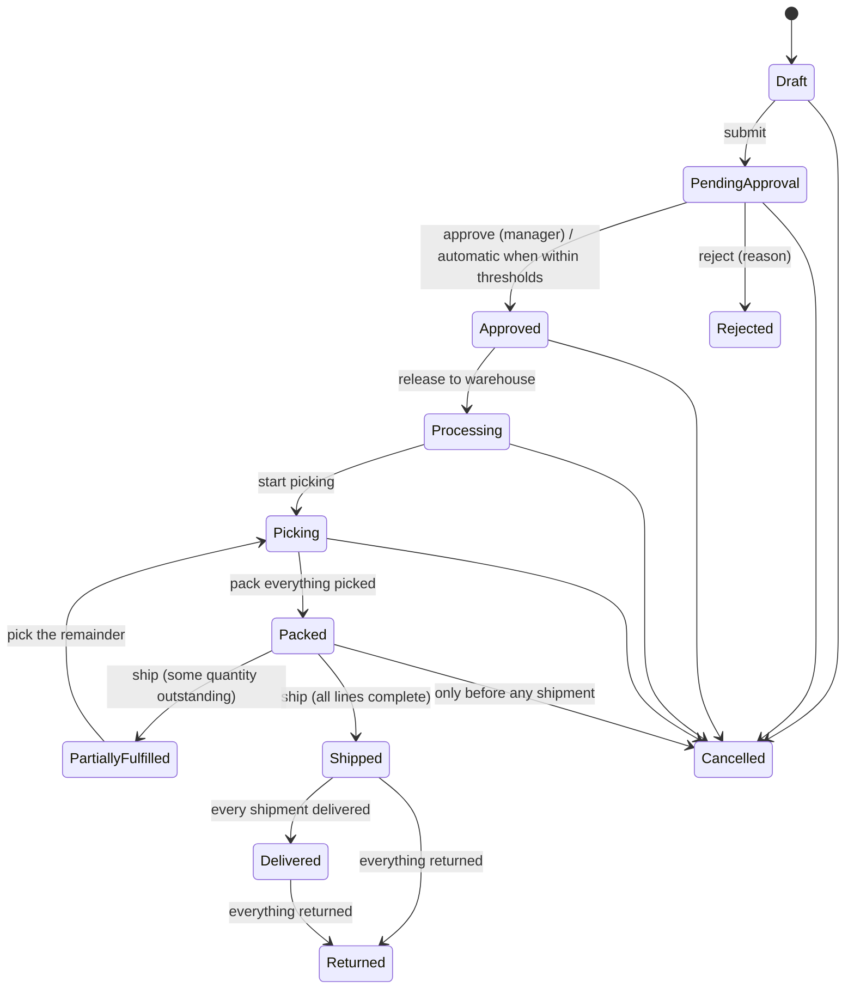

# Orders, fulfillment and invoicing

## Lifecycle



| Step | Stock | Money | Side effects |
|---|---|---|---|
| Submit | | | Approval rules evaluated; within thresholds the order is approved in the same transaction |
| Approve | **Reserve** each line (`Reservation` movements + one `stock_reservations` row per line) | **Invoice issued** (`INV-…`, due date = customer terms or org default) | Jobs: invoice PDF (→ emailed to the customer), order confirmation email |
| Pick / pack | | | Per-line quantities; `shipped ≤ packed ≤ picked ≤ ordered` enforced by the domain **and** a CHECK constraint |
| Ship | **Stock out** against the reservation (on hand −, reserved −) | | `Shipment` (`SHP-…`), shipment email, `shipment.updated` realtime |
| Return | **Returned** movement for restockable units | **Credit** on the invoice (net price incl. tax × qty) | `SalesReturn` (`RMA-…`) |
| Cancel | **Release** remaining reservations | Invoice **cancelled** (refused if any payment exists) | |
| Payment | | `AmountPaid` += amount; status Partially Paid / Paid | |

### Approval workflow (configurable per organization)

`PUT /api/organization/settings`:

| Setting | Effect |
|---|---|
| `requireApprovalForAllOrders` | Every order waits for a manager |
| `orderApprovalAmountThreshold` | Orders whose **total** exceeds it wait for approval (0 = no amount rule) |
| `orderApprovalQuantityThreshold` | **Bulk** orders whose total quantity exceeds it wait for approval (0 = no quantity rule) |
| Customer `creditLimit` | If open balance + order total exceeds it, the order waits for approval |

Approval requires `orders.approve` (FinanceManager, OrganizationAdmin). **Segregation of duties:** the creator of
an order can never approve it (`self_approval`). Automatic approval is performed by the system on submit and
is only possible when no rule applies.

### Pricing

Per line: `subtotal = qty × unit price` (price defaults to the product's selling price), line discount %,
then the order discount % on the discounted amount, then tax (`product.taxRate ?? org.defaultTaxRate`) on the
net amount. Each step rounds half away from zero to 2 decimals. Order totals are sums of line amounts, so
the invoice always equals the order.

## Transactional approval

```mermaid
sequenceDiagram
    autonumber
    participant C as Client
    participant F as Idempotency filter
    participant S as SalesOrderService
    participant L as InventoryLedger
    participant DB as PostgreSQL
    participant W as Worker
    C->>F: POST /api/orders/{id}/approve  (Idempotency-Key: K)
    F->>DB: INSERT idempotency_records (tenant, K) ON CONFLICT DO NOTHING
    alt K already completed
        F-->>C: stored response (Idempotent-Replayed: true)
    end
    F->>S: ApproveAsync
    S->>DB: BEGIN (READ COMMITTED, inside retrying execution strategy)
    S->>DB: SELECT order + lines (xmin)
    S->>S: guard PendingApproval → Approved, approver ≠ creator
    S->>L: LoadAsync(lines) — balance rows in id order (xmin)
    loop each line (product order)
        S->>L: Reserve(qty) — throws insufficient_stock
        L->>DB: INSERT stock_movements (Reservation), stock_reservations
    end
    S->>DB: UPSERT tenant_sequences → INV-000123
    S->>DB: INSERT invoices + invoice_lines  (unique tenant_id+sales_order_id)
    S->>DB: INSERT outbox_messages (invoice PDF, confirmation email)
    S->>DB: INSERT audit_logs ; UPDATE sales_orders WHERE xmin = …
    S->>DB: COMMIT
    alt xmin conflict / deadlock / serialization failure
        S->>S: rollback, clear change tracker, re-run (≤ 8 attempts)
    end
    F->>DB: UPDATE idempotency_records SET response
    F-->>C: 200 OrderDto
    W->>DB: claim outbox (FOR UPDATE SKIP LOCKED) → render PDF → store → email customer
```

Every failure path leaves the database exactly as it was: no reservation, no invoice, no consumed invoice
number, no outbox job, and the order stays `PendingApproval`.

### Duplicate and concurrent requests

| Scenario | Protection |
|---|---|
| Client retries `POST /api/orders` | Required `Idempotency-Key` → replayed response; the key is also stored on the order (`unique (tenant_id, idempotency_key)`), so even a lost idempotency record cannot create a twin |
| Two managers approve the same order at once | `xmin` on the order: the loser retries, sees `Approved`, gets `409 invalid_state` |
| Approval retried with a new key | State guard → `409 invalid_state`; `unique (tenant_id, sales_order_id)` on invoices makes a second invoice impossible |
| Many approvals compete for the last units | Each reservation hits the same balance rows; `xmin` conflicts retry against fresh stock, and losers fail with `insufficient_stock` — never oversold (test: 5 approvals × 10 units for 30 units → exactly 3 approved) |
| Ship retried | Required idempotency key; `Ship` only ships `packed − shipped`, so a second ship of the same pack is `invalid_state` |
| Payment retried | Required idempotency key; `amount ≤ balance` and the invoice CHECK `amount_paid + credited ≤ total` |

## Fulfillment

* The picking/packing queue (`GET /api/fulfillment/queue?warehouseId=`) lists approved orders not yet fully
  shipped, ordered by required date then approval time. Warehouse staff see only their warehouses.
* Partial fulfillment: pick and pack less than ordered, then ship. The order becomes `PartiallyFulfilled`
  and the rest stays reserved; pick again later. Each shipment is its own `Shipment` row.
* Delivery is confirmed per shipment. The order becomes `Delivered` when it is fully shipped and every
  shipment is delivered.

## Invoices and payments

* Statuses: `Draft`, `Issued`, `PartiallyPaid`, `Paid`, `Overdue`, `Cancelled`. The status follows the balance
  (`total − paid − credited`) and the due date. The worker marks unpaid invoices `Overdue` daily
  (`mark-overdue-invoices`).
* Invoice numbers come from `tenant_sequences` inside the approval transaction: gap-free and unique per
  organization.
* PDFs are rendered asynchronously by the worker (QuestPDF) and stored in `stored_files`.
  `GET /api/invoices/{id}/pdf` returns `404 pdf_pending` until the PDF is ready, and
  `POST /api/invoices/{id}/regenerate-pdf` re-renders it.
* QuestPDF's Community licence is free for organizations with annual revenue under USD 1M. Larger
  operators need a commercial licence.
* `GET /api/finance/summary` returns invoiced and collected amounts per month, outstanding and overdue
  totals, payments over the last 30 days and the most overdue invoices.
