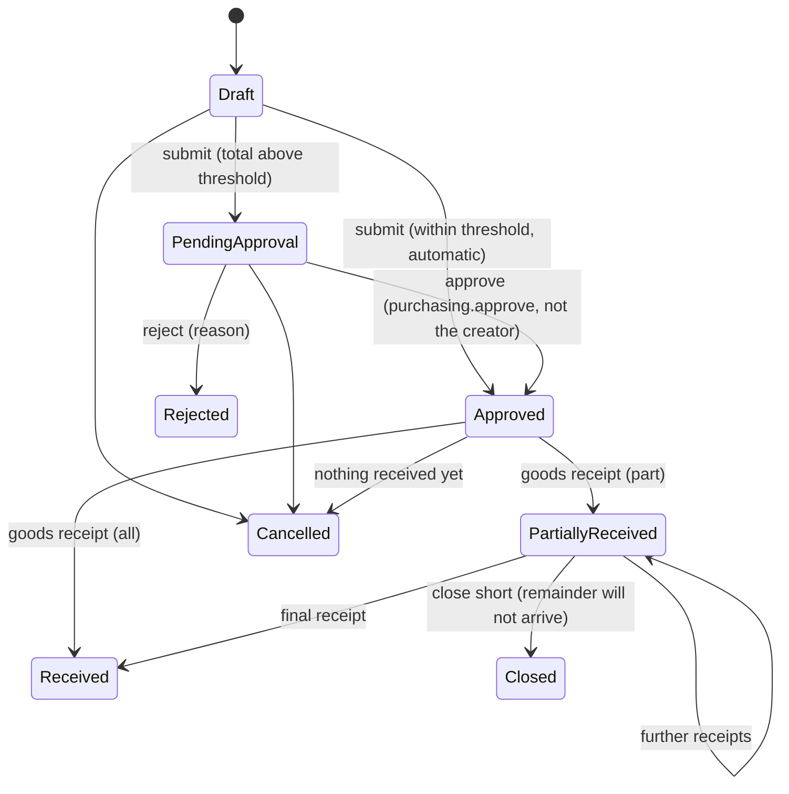

# Procurement and accounts payable

## Suppliers

`/api/suppliers` holds supplier profiles: contact, address, tax number, payment terms and lead time.

Each supplier has **supplier products** (`/api/suppliers/{id}/products`): their SKU, negotiated unit cost,
minimum order quantity, lead time and a *preferred* flag. A partial unique index allows at most one
preferred supplier per product. When a purchase-order line has no explicit cost, it takes the supplier's
negotiated cost, falling back to the product's cost price.

## Purchase orders

* The **approval threshold** is the organization setting `purchaseApprovalThreshold` (default 5,000). Orders
  with a total above it need `purchasing.approve` (FinanceManager or OrganizationAdmin). A threshold of `0`
  means every purchase order needs approval.
* **Segregation of duties.** The creator cannot approve their own purchase order, and warehouse staff hold
  neither `purchasing.approve` nor `purchasing.create`.
* Creating, submitting, approving and receiving all require an `Idempotency-Key`. Like sales orders, a
  purchase order also stores its key under a unique index, so a retried create can never produce a twin.

### Goods receipts (GRN)

`POST /api/purchase-orders/{id}/receipts` records one delivery, and partial deliveries are allowed.
In a single transaction it:

1. advances each line's received quantity (over-receipt is rejected with `over_receipt`, and a CHECK
   constraint enforces `quantity_received ≤ quantity`);
2. creates the `GoodsReceipt` (`GRN-000001`) with the supplier's delivery note;
3. writes a **Stock In** movement per line at the purchase-order unit cost, referencing the GRN, which updates
   the weighted-average cost;
4. moves the PO to `PartiallyReceived` or `Received`.

Receiving needs `purchasing.receive` plus access to the receiving warehouse, so warehouse staff can receive
only into their own warehouse.

### Reorder suggestions

`GET /api/purchase-orders/suggestions?warehouseId=` lists low-stock products (available ≤ reorder level)
together with:

* the quantity already **on order** from approved and partially received POs;
* the preferred supplier and their unit cost;
* a suggested quantity: `reorder level + reorder quantity − available − on order`, rounded up to the
  supplier's minimum order quantity.

## Accounts payable

* **Supplier invoices** (`/api/supplier-invoices`, `SINV-000001`) record a supplier bill: the supplier's own
  invoice number, invoice and due dates, subtotal and tax. The due date defaults to the supplier's payment
  terms.
* A unique index on `(tenant, supplier, supplier invoice number)` stops the same bill being booked twice
  (`duplicate_supplier_invoice`).
* **Three-way match.** When the bill references a purchase order, `matchesReceipts` is true only if
  everything invoiced against that PO does not exceed the value of goods received (quantity received × cost
  incl. tax). Unmatched bills are flagged for review.
* **Payments** (`POST /api/supplier-invoices/{id}/payments`, idempotency key required) cannot exceed the
  balance. The status moves Open → PartiallyPaid → Paid, and the worker marks unpaid bills past their due date
  `Overdue` daily.
* Permissions: `payables.view` (FinanceManager, ProcurementOfficer, Auditor) and `payables.manage`
  (FinanceManager).
